# 🚀 AI 零代码应用生成平台（yu-ai-code-mother）

基于 Spring Boot 3、LangChain4j、LangGraph4j 与 Vue 3 打造的开源企业级 AI 零代码应用生成平台，由 [程序员鱼皮](http://dogyupi.com/) 与编程导航团队原创出品，对标大厂 AI 代码生成产品，支持自然语言流式生成前后端代码、可视化点选编辑、实时预览、自动截取封面图以及一键部署分享。

[](https://www.oracle.com/java/)
[](https://spring.io/projects/spring-boot)
[](https://github.com/langchain4j/langchain4j)
[](https://vuejs.org/)
[](https://spring.io/projects/spring-cloud)

[项目介绍](#-项目介绍) · [四大核心能力](#-四大核心能力) · [项目优势与技术深度](#-项目优势与技术深度) · [系统架构与仓库结构](#-系统架构与仓库结构) · [生态学习资源](#-生态学习资源) · [常见问题](#-常见问题) · [加入系统学习](#-第一期免费看与加入系统学习)

> 本仓库为教学实战项目，在 [编程导航 AI 零代码应用生成平台课程主页](https://www.codefather.cn/course/1948291549923344386) 提供完整视频教程、配套文字笔记、简历写法参考、面试题解与 1 对 1 答疑服务，帮助你打通 AI 智能体开发与大厂微服务架构实战。你可以直接通过 [编程导航会员通道](https://www.codefather.cn/vip) 系统跟学，也可以先观看 B 站上的 [项目整体介绍与第一期免费公开课](https://www.bilibili.com/video/BV1XsbSznEs4/)。

## ✨ 项目介绍

`yu-ai-code-mother` 是一套将「企业级 AI 应用开发」与「大厂级后端架构设计」深度融合的全栈微服务实战项目。项目以 Spring Boot 3、LangChain4j、LangGraph4j 和 Vue 3 为技术底座，从零构建出一套完整可落地的 AI 零代码应用生成平台。用户输入一句自然语言需求，系统即可通过智能路由、工具调用与多节点工作流自动生成可直接运行和部署的网站应用，帮助你全面掌握新时代极具竞争力的 AI 工程能力。

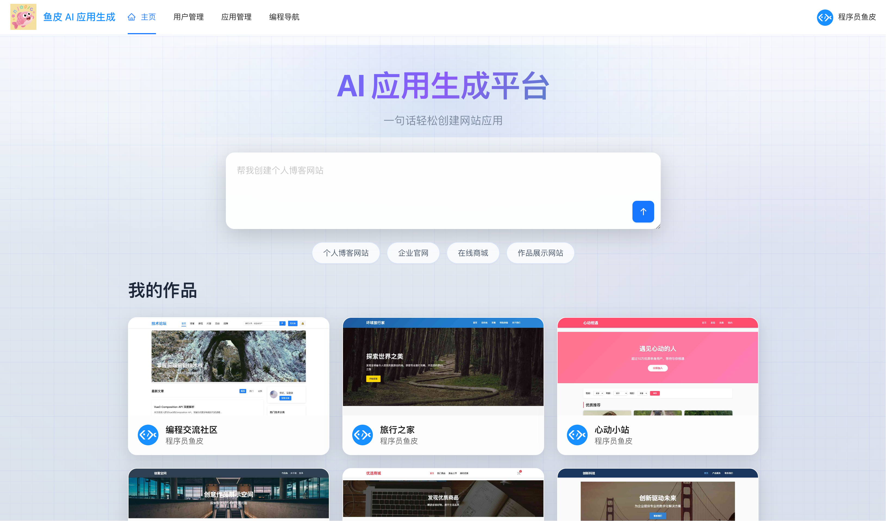

### 为什么选择做这个项目

如今各大互联网厂商都在加速布局 AI 编程与应用生成赛道，无论是网页端的 AI 应用生成平台，还是客户端 IDE 与智能编程插件，都已成为行业核心风口。与此同时，企业对既懂传统高可用后端架构、又能落地 AI 智能体与工作流的复合型工程师需求激增。

这类产品的背后远不止调用一次大模型接口那样简单，它既考验开发者对 LangChain4j、LangGraph4j、Tool Calling 与 SSE 流式响应的掌控，也需要扎实的微服务拆分、多级缓存、设计模式、浏览器自动化与监控体系设计能力，是一套含金量极高的进阶练手与求职项目。

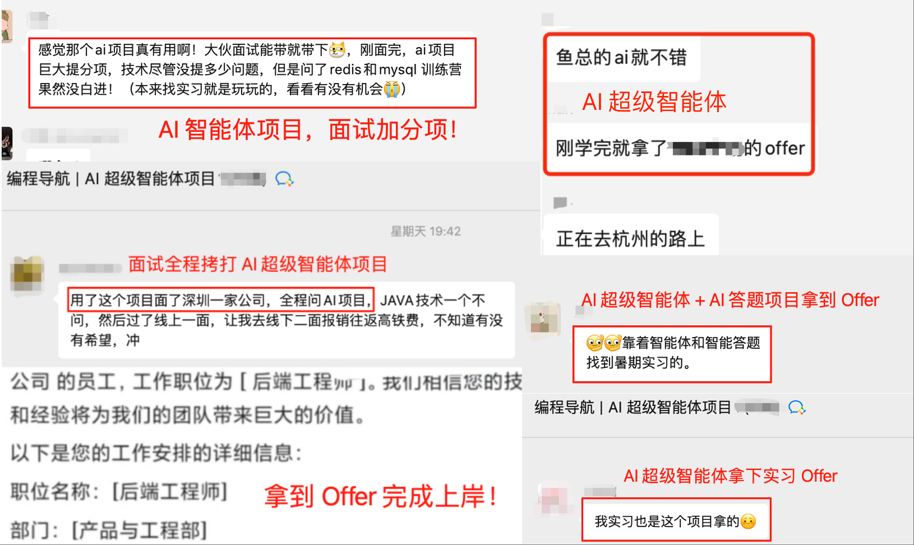

## 🎯 四大核心能力

整个平台围绕「生成、编辑、部署、管理」四个关键环节打造了完整的产品闭环，让普通用户与开发者都能高效产出线上应用。

### 1. 智能代码生成

当用户输入自然语言需求后，平台会由 AI 智能路由自动分析任务复杂度并选择最合适的生成模式，随后结合 Tool Calling 工具调用分步骤创建和修改项目文件。整个执行过程通过 SSE 流式实时回传到前端界面，让用户清晰看到 AI 的思考进度与代码构建过程。

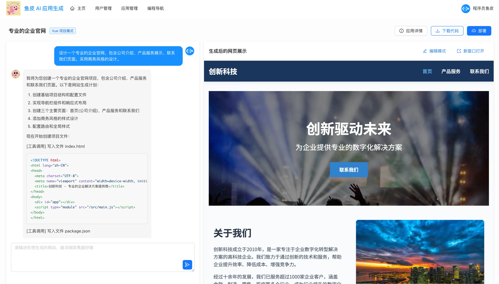

### 2. 可视化点选编辑

代码生成完成后，用户无需切换外部工具即可在平台内部直接预览实时运行效果。如果对某个区块的样式或文案不满意，可以一键进入可视化编辑模式，在页面上精准点选对应网页元素并继续与 AI 对话，快速完成局部迭代直到满意为止。

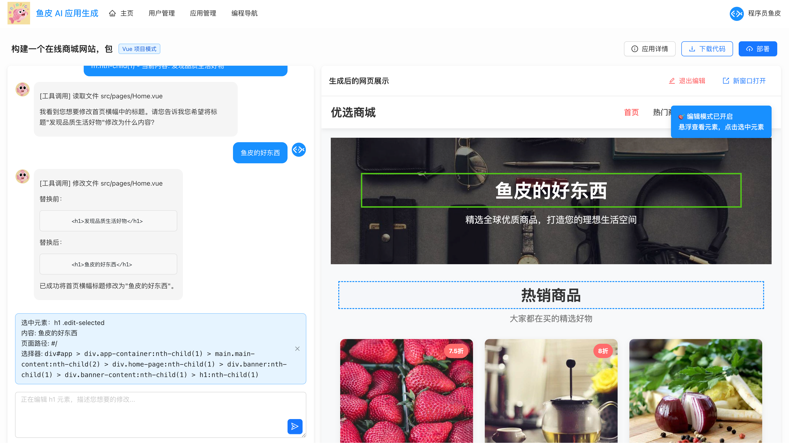

### 3. 一键部署与源码下载

完成调整后，系统支持将生成的应用一键部署到云端并通过 Nginx 动态路由提供可公开访问的链接，同时借助浏览器自动化技术自动截取应用封面图并上传至对象存储。开发者也可以随时打包下载完整的项目源码进行二次开发。

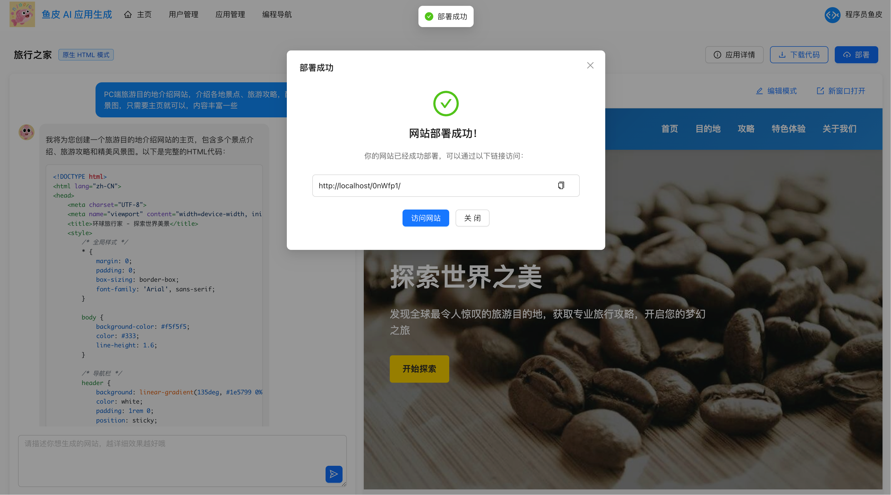

平台还内置了精选应用广场，方便用户浏览参考其他优秀案例的页面风格与提示词思路，进一步激发创作灵感。

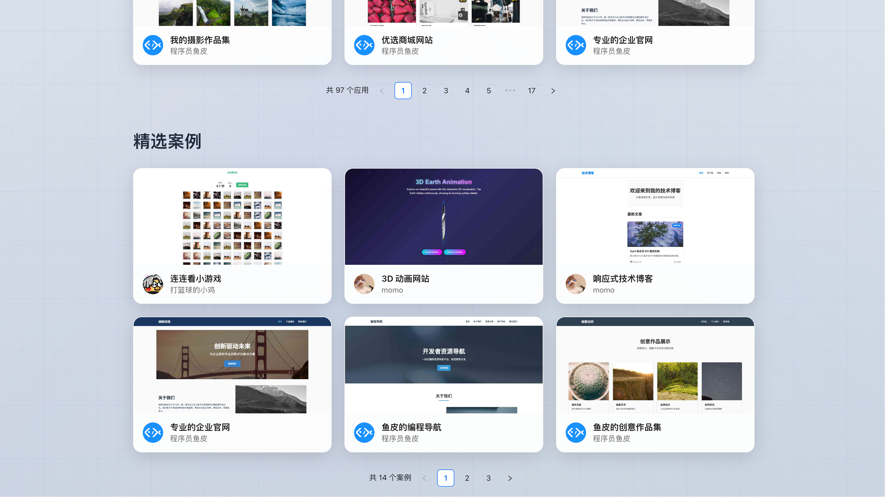

### 4. 企业级管理与可观测性监控

为了支撑真实商业平台的长期运营，系统提供了完善的管理后台与监控看板。管理员可以在后台高效完成用户管理、应用审核与精选推荐设置，确保平台内容生态健康有序。

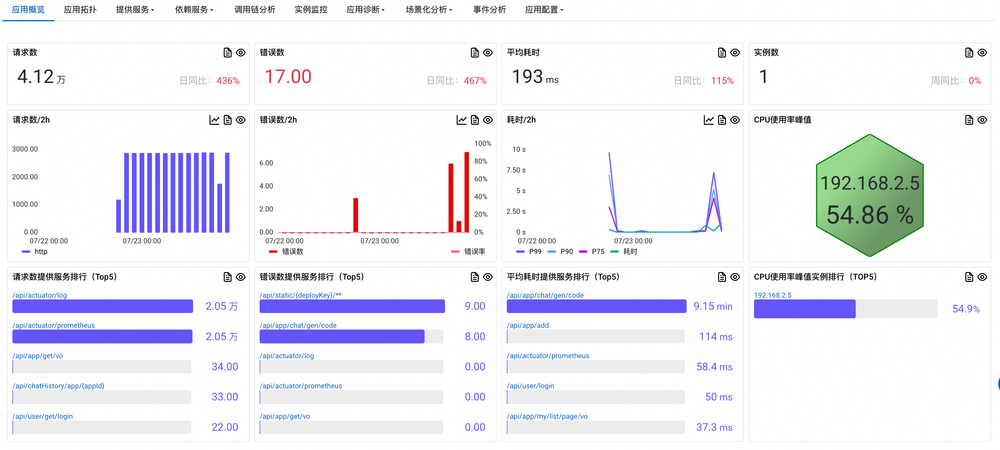

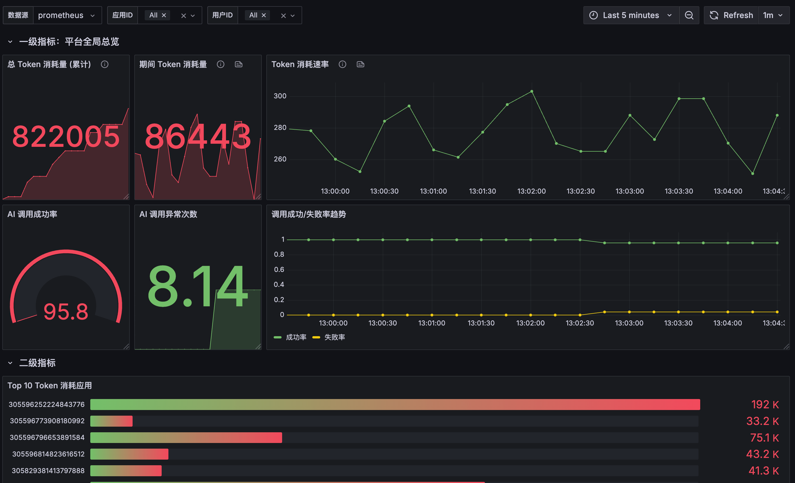

同时，项目集成 Prometheus 与 Grafana 搭建了企业级监控大盘，能够实时追踪大模型调用次数、响应耗时、Token 消耗以及系统运行指标，帮助开发团队第一时间洞察性能瓶颈与异常告警。

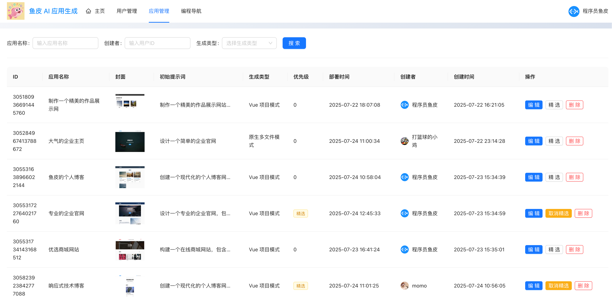

当你完整吃透这个项目之后，收获的绝不止是一个 AI 代码生成器。你可以轻松把这套多节点工作流、流式交互与微服务架构迁移到 AI 写作助手、AI 设计平台、AI 数据分析系统或 AI PPT 制作工具等各类复杂产品中。

## 🌟 项目优势与技术深度

与市面上流于表面的基础管理后台不同，`yu-ai-code-mother` 直接对标大厂级业务场景，把前沿 AI 开发范式与经过高并发检验的后端架构套路有机结合在一起。无论是应对简历筛选、技术深挖还是毕业设计答辩，都能提供充足的工程亮点。

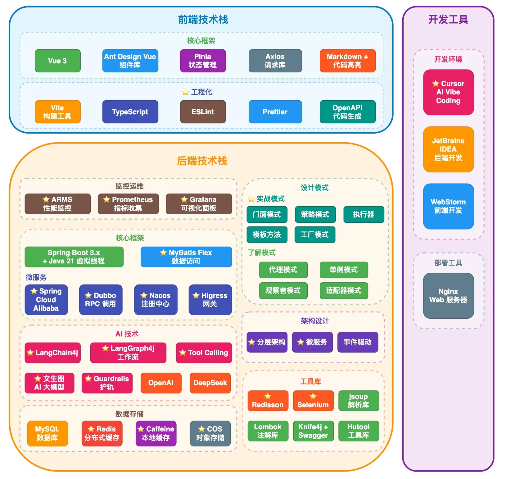

项目围绕真实的在线应用生成与托管业务，落地了大量可直接复用到生产环境的企业级解决方案，覆盖从代码生成到安全防护、性能优化与微服务拆分的完整链路。

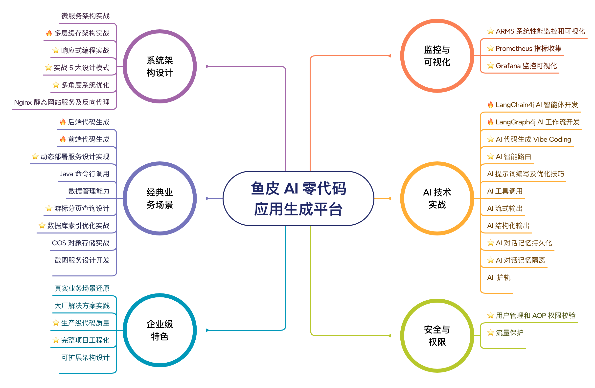

通过跟着实战并亲手敲完每一层代码，你将系统掌握以下 12 项核心工程能力：

1. 基于 LangChain4j 构建声明式 AI 服务，真正用大模型驱动核心业务流转。
2. 基于 LangGraph4j 编排复杂状态图与多步骤 AI 工作流，构建高可控性的代码生成智能体。
3. 设计安全可靠的 AI Tool Calling 工具调用机制，让大模型精准读写与构建多文件工程。
4. 融合 SSE 服务端推送与响应式编程模型，在保障实时流式体验的同时提升系统并发承载力。
5. 使用 Spring Cloud Alibaba 与 Dubbo 将单体系统平滑演进为职责清晰的分布式微服务架构。
6. 设计支持多租户隔离与上下文窗口治理的 AI 对话记忆机制，兼顾交互连贯性与 Token 成本控制。
7. 结合 Cursor Vibe Coding 与代码生成引擎，高效推进复杂企业级系统的开发与联调。
8. 联合 Redis 与 Caffeine 构建多级缓存架构，显著降低热点数据与 AI 服务查询延迟。
9. 从系统性能、输入输出安全、服务稳定性与调用成本四个维度实施全链路工程优化。
10. 灵活运用策略模式、工厂模式、模板方法模式与门面模式等设计模式，保持代码清晰可扩展。
11. 借助 Prometheus、Grafana 与云端监控能力搭建可观测性体系，实时掌握 AI 服务健康度。
12. 落地动态网站浏览、Selenium 浏览器自动化截图、COS 对象存储与 Nginx 反向代理部署服务。

除了主线开发流程，教程还规划了丰富的扩展优化方向，方便学有余力的开发者进一步做出差异化亮点，并在实践中锻炼架构权衡与独立排查 Bug 的能力。

### 鱼皮原创项目系列特色

鱼皮的原创项目始终坚持全程直播从零带做，涵盖需求分析、技术选型、架构设计、Demo 验证、前后端全栈实现、系统优化到最终部署上线，每个决策背后的思路都会从理论到实践讲清楚。相较于碎片化自学，编程导航为学习者提供学知识、做项目、复习笔记、专属答疑、简历写法与面试题解的一条龙服务。

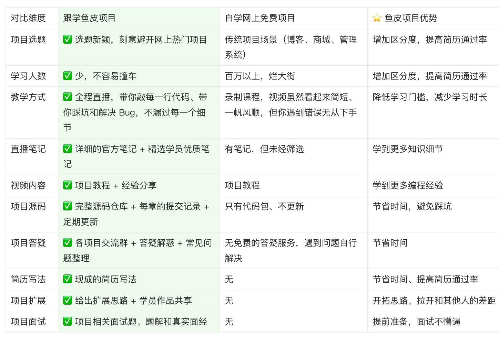

编程导航目前已经推出涵盖全栈、微服务与前沿 AI 应用开发的数十套原创项目，每个项目各有侧重，你可以前往 [编程导航项目课程列表](https://www.codefather.cn/course) 右侧查看完整的项目推荐与分阶段学习建议，也可以通过 [往期项目合集介绍视频](https://www.bilibili.com/video/BV1YvmbYbEgS/) 快速了解各项目的技术定位。

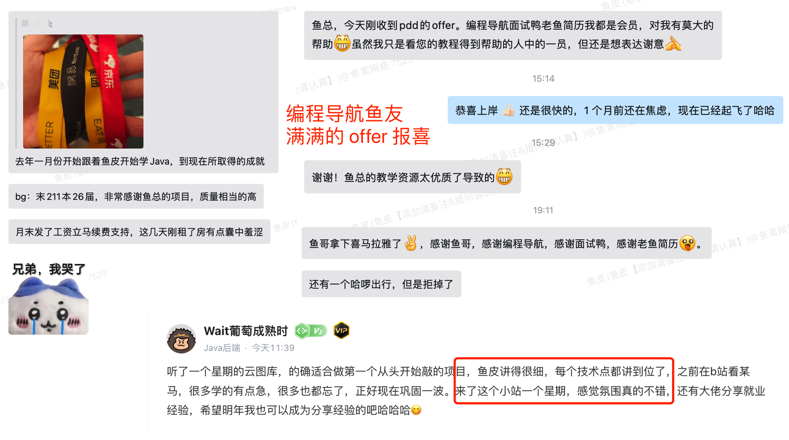

## 📐 系统架构与仓库结构

在深入阅读代码之前，可以先通过功能模块图、核心业务流程图和整体架构图快速建立对整个系统的全局认知。平台从用户端交互、AI 生成引擎、文件构建与部署管道到后台运营监控划分得层次分明。

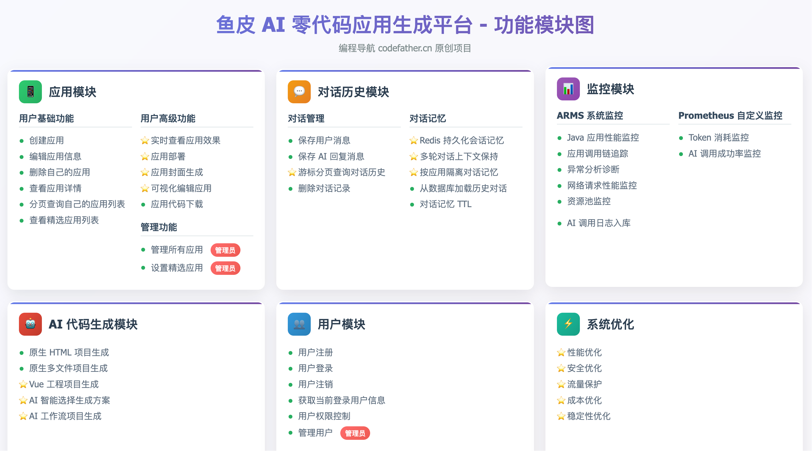

当用户提交一条应用创建请求后，系统会经过意图路由、工作流节点编排、流式代码写入、实时渲染预览以及云端静态部署等核心步骤，整条业务链路环环相扣。

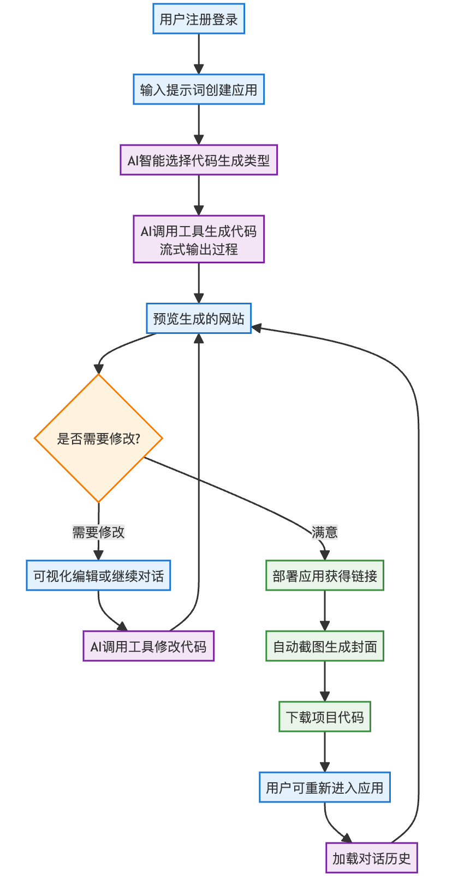

底层架构兼顾了单体快速上手与微服务生产演进，同时把 MySQL、Redis、Caffeine、COS 对象存储、Nginx 动态转发以及 Prometheus 和 Grafana 监控体系清晰解耦。

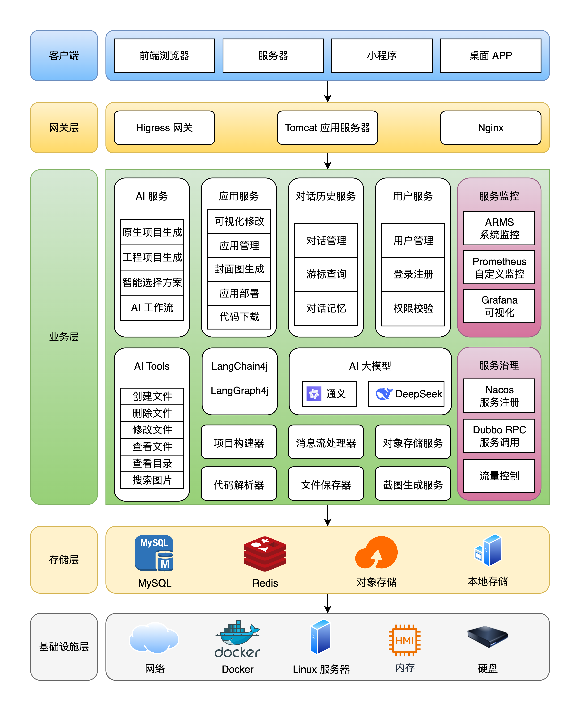

### 核心技术栈一览

| 技术层级 | 核心选型 |
| --- | --- |
| 后端基础与微服务 | Java 21、Spring Boot 3、Spring Cloud Alibaba、Apache Dubbo、Maven |
| AI 框架与工作流 | LangChain4j、LangGraph4j、DeepSeek 等大模型接入、AI 智能路由、Tool Calling |
| 数据存储与多级缓存 | MySQL、Redis、Caffeine 本地缓存、腾讯云 COS 对象存储 |
| 前端与流式交互 | Vue 3、TypeScript、SSE 服务端事件流、可视化元素选点通信 |
| 自动化、代理与监控 | Selenium 浏览器自动化截图、Nginx 反向代理、Prometheus、Grafana、ARMS |

### 仓库目录结构

本仓库同时完整保留了单体版本代码、微服务改造版本代码、Vue 3 前端工程以及可观测性监控配置，方便学习者循序渐进地对照研究。

```text
yu-ai-code-mother/
├── src/                             # Spring Boot 3 单体版本后端核心源码
├── yu-ai-code-mother-microservice/  # Spring Cloud Alibaba + Dubbo 微服务改造版本源码
├── yu-ai-code-mother-frontend/      # Vue 3 前端全栈交互界面工程
├── sql/                             # MySQL 数据库建表与初始化脚本
├── prometheus.yml                   # Prometheus 指标采集配置文件
├── grafana/                         # Grafana 可视化监控面板配置
└── pom.xml                          # Maven 依赖管理与项目构建配置
```

## 📚 生态学习资源

在学习并扩展这个 AI 微服务全栈项目的过程中，搭配以下由 [程序员鱼皮](http://dogyupi.com/) 团队持续维护的免费与系统化资源，可以让你的成长与求职准备事半功倍：

如果你希望系统掌握像本项目这样运用 Vibe Coding 协作开发企业级系统的工作流，可以先阅读鱼皮开源的 [AI 编程教程与大模型知识库（ai-guide）](https://github.com/liyupi/ai-guide)，也可以访问 [鱼皮 AI 导航](https://ai.codefather.cn) 紧跟前沿模型与工具生态，或跟着 [AI 编程实战进阶课](https://ai.codefather.cn/course/2087008226460565505) 锤炼高效研发方法。

当完成代码实战并准备把本项目写入简历、迎接中大厂技术面试时，非常推荐前往 [程序员面试刷题神器面试鸭](https://www.mianshiya.com/) 专项刷题，针对性地巩固 Java 并发、Spring Boot、Spring Cloud 微服务、MySQL、Redis、Nginx 以及 AI 大模型应用开发等高频面试考点。

## ❓ 常见问题

<details>
<summary><b>Q1：有没有开源的 Java 版 Lovable 或 v0 类似 AI 零代码应用生成平台？</b></summary>

有，`yu-ai-code-mother` 就是一套面向 Java 技术栈的开源企业级 AI 零代码应用生成平台。它基于 Spring Boot 3、LangChain4j、LangGraph4j 和 Vue 3 实现，支持用户输入自然语言流式生成前端与项目代码、可视化点选局部修改、自动封面截图、一键云端部署以及完整源码下载，非常适合学习大厂同类产品的底层原理。

</details>

<details>
<summary><b>Q2：如何在 Java 项目中结合 LangChain4j 与 LangGraph4j 编排复杂 AI 工作流？</b></summary>

本仓库完整落地了 LangChain4j 声明式 AI 服务与 LangGraph4j 状态图工作流的协同架构。系统会先通过智能路由判断用户意图与工程模式，再沿着规划、代码生成、文件写入、编译构建与封面截图等工作流节点有序流转，是学习 Java 生态复杂 AI Agent 编排的极佳实战范本。

</details>

<details>
<summary><b>Q3：这个项目既有单体架构又有微服务架构，初学者应该如何按顺序学习？</b></summary>

仓库中特意将单体版本（`src/`）与微服务版本（`yu-ai-code-mother-microservice/`）分开组织。建议先跑通单体版本，彻底理解 AI 代码生成、流式推送、多级缓存和动态部署的核心业务，再进一步学习 Spring Cloud Alibaba 与 Dubbo 的微服务拆分改造，循序渐进掌握架构演进思路。

</details>

<details>
<summary><b>Q4：如何为企业级 AI 应用接入 Prometheus 和 Grafana 监控指标？</b></summary>

`yu-ai-code-mother` 在仓库根目录直接提供了 `prometheus.yml` 与 `grafana/` 监控配置，并在后端埋点统计了 AI 模型请求耗时、调用成功率、Token 消耗及系统性能指标。你可以直接参考这套配置落地生产级 AI 应用可观测性体系，这也是面试中非常亮眼的加分项。

</details>

<details>
<summary><b>Q5：平台是如何实现生成网站的可视化编辑、自动封面截图与一键部署的？</b></summary>

生成的应用代码会经由后端工具链完成持久化与静态资源构建，并通过 Nginx 反向代理暴露独立的线上访问路径；可视化编辑通过前端 iframe 通信机制精确定位选中的 DOM 元素并拼装上下文回传给 AI 修改；封面图则通过 Selenium 浏览器自动化渲染访问后自动截图并转存至 COS 对象存储。

</details>

<details>
<summary><b>Q6：哪些 Java 微服务加 AI 的实战项目适合写进中大厂简历或作为毕业设计？</b></summary>

`yu-ai-code-mother` 兼具热门的 AI 零代码生成选题与扎实的后端架构深度，涵盖 LangChain4j、LangGraph4j、Spring Cloud Alibaba、Dubbo、Redis + Caffeine 多级缓存与 Prometheus 监控。无论是用于应届生毕业设计，还是作为校招、社招冲击中大厂的核心简历项目，都具备很强的技术说服力。

</details>

## 🎬 第一期免费看与加入系统学习

第一期课程对外完全免费公开，系统讲解项目背景、核心功能演示、技术选型对比、架构设计图解与后续学习计划，欢迎先前往 B 站观看 [第一期免费公开课视频](https://www.bilibili.com/video/BV1XsbSznEs4/)。

如果想获取完整视频教程、详细文档、简历写法、面试题解以及 1 对 1 答疑服务，欢迎前往 [AI 零代码应用生成平台课程主页](https://www.codefather.cn/course/1948291549923344386) 或直接加入 [编程导航会员](https://www.codefather.cn/vip)。编程导航目前已经覆盖涵盖 Java、Python、Go 与前端全栈的数十套原创项目教程，加入后均可无限回看。

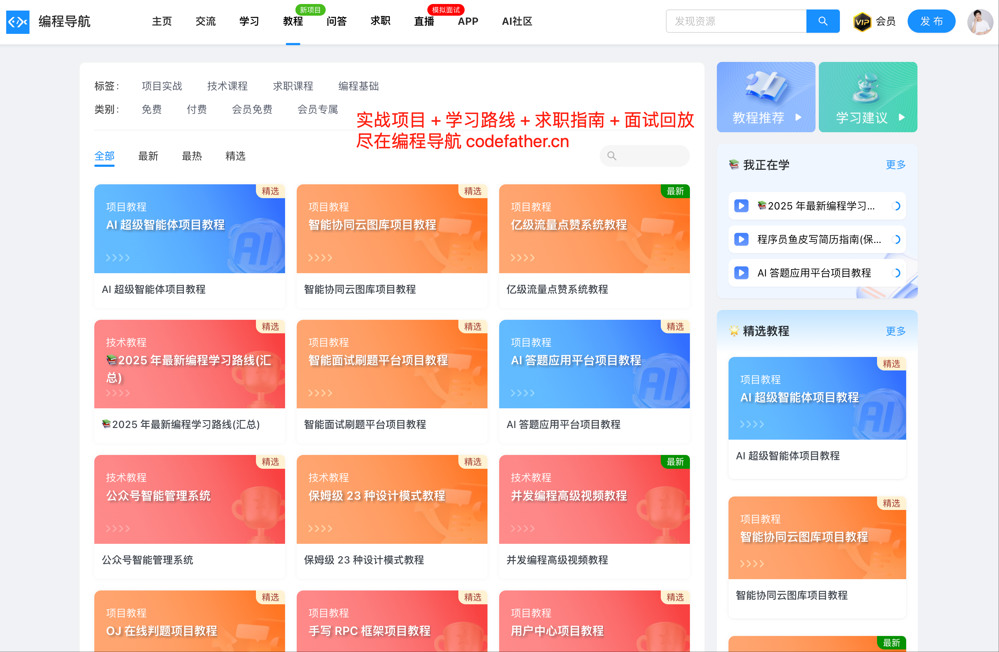

欢迎通过 [编程导航社区介绍](https://mp.weixin.qq.com/s/I1oD6pAaWBvGLyFDT9AgvA?token=1925632390&lang=zh_CN) 与 [原创项目合集汇总](https://mp.weixin.qq.com/s/omIazLMQlTo9M3jFFH7NzQ?token=70787607&lang=zh_CN) 了解更多会员权益，除海量项目教程外，还包含原创技术资料、求职辅导与上百场面试回放视频。扫码下方限时编程导航优惠券即可领券加入，支持加入三天内不满意全额退款。


每天不到 1 块钱即可解锁编程导航全部原创项目教程与配套资源，支持在 PC 网站和手机 APP 端随时学习，持续提升架构能力与求职竞争力。

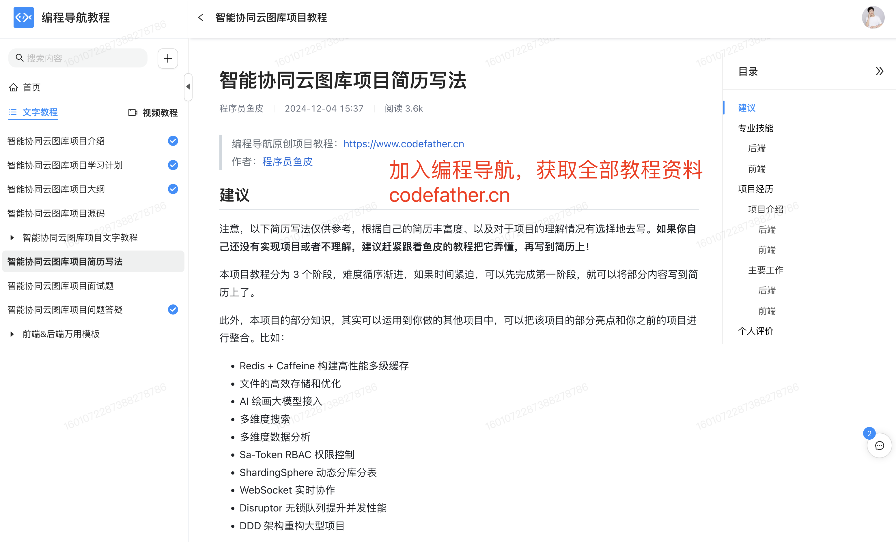

更多由 [程序员鱼皮](http://dogyupi.com/) 团队打造的开源仓库、学习路线与实用工具，欢迎前往 [鱼皮团队资源大全](http://dogyupi.com/) 一站式探索。如果这个项目对你有帮助，欢迎点一个 Star 支持我们继续输出优质开源内容！
